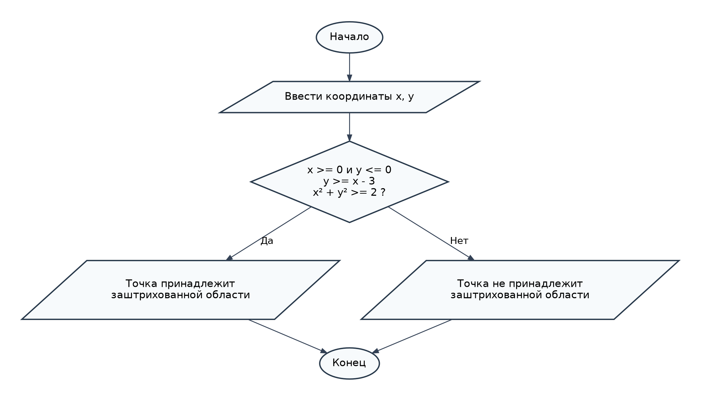

# Домашнее задание к лабораторной работе № 6 — вариант 8

## Условие задачи

Составить программу, которая проверяет, принадлежит ли точка с координатами `(x, y)` заштрихованной области на рисунке варианта 8, и выводит сообщение. Проверить программу на контрольных примерах.

## 1. Алгоритм и блок-схема

### Алгоритм

1. Начало.
2. Ввести координаты точки `x` и `y`.
3. Проверить, что точка расположена справа от оси `Oy` (`x >= 0`) и не выше оси `Ox` (`y <= 0`).
4. Проверить, что точка находится над прямой `y = x - 3` (`y >= x - 3`).
5. Проверить, что точка находится вне окружности `x² + y² = 2` (`x*x + y*y >= 2`).
6. Если все условия выполнены, вывести сообщение о принадлежности области; иначе — о непринадлежности.
7. Конец.

### Блок-схема



[Открыть блок-схему](images/block_scheme.png)

## 2. Реализация программы

Файл `Homework.c`:

```c
#define _CRT_SECURE_NO_WARNINGS
#include <stdio.h>
#include <windows.h>

int main(void)
{
    SetConsoleOutputCP(65001);
    double x, y;

    printf("Введите координаты x и y: ");
    if (scanf("%lf %lf", &x, &y) != 2) {
        printf("Ошибка ввода.\n");
        return 1;
    }

    if (x >= 0 && y <= 0 && y >= x - 3 && x * x + y * y >= 2)
        printf("Точка принадлежит заштрихованной области.\n");
    else
        printf("Точка не принадлежит заштрихованной области.\n");

    return 0;
}
```

Программа предназначена для Microsoft Visual Studio на Windows. Для корректного отображения русского текста сохраните исходный файл в UTF-8.

## 3. Результат работы программы

**Контрольный пример 1:** `2 -0.5`

```text
Введите координаты x и y: 2 -0.5
Точка принадлежит заштрихованной области.
```

**Контрольный пример 2:** `1 -1`

```text
Введите координаты x и y: 1 -1
Точка принадлежит заштрихованной области.
```

**Контрольный пример 3:** `0 -1`

```text
Введите координаты x и y: 0 -1
Точка не принадлежит заштрихованной области.
```

**Вывод:** программа проверяет все четыре ограничения и определяет принадлежность точки заштрихованной области, включая её границы.

## 4. Информация о разработчике

Жаворонков Богдан, бТИИ-262.
